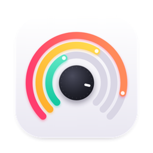
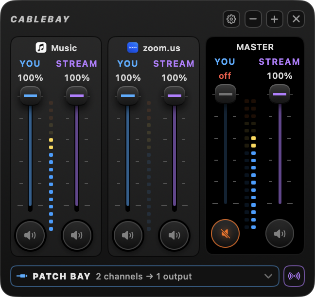
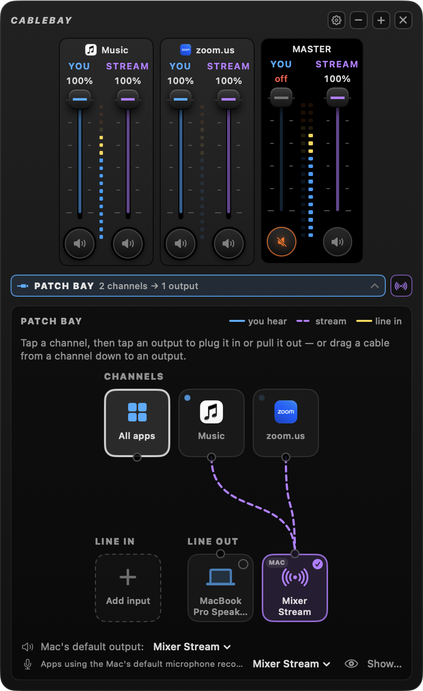
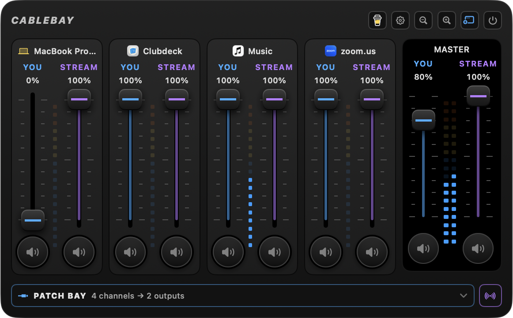

<p align="center">
  
</p>

<h1 align="center">Cablebay</h1>

<p align="center">
  <b>A studio-style audio mixer for macOS.</b><br>
  Mix every app and microphone twice — once for what you hear, once for your stream — and patch them with cables like a studio desk.<br>
  <sub>by <b>Nima Sarabi</b></sub>
</p>

<p align="center">
  <a href="https://github.com/nimasarabi/Cablebay/releases/latest/download/Cablebay-1.1.dmg">
    
  </a>
</p>

<p align="center">
  
  
  
  
  
</p>

<p align="center">
  <a href="https://buymeacoffee.com/cablebay">
    
  </a>
  <br><br>
  <a href="https://buymeacoffee.com/cablebay">
    
  </a>
  <br>
  <sub>Cablebay is free. If it's useful, a coffee helps fund updates ☕</sub>
</p>

---

<p align="center">
  
  &nbsp;&nbsp;
  
</p>

## Why Cablebay?

macOS has one volume slider for everything. Cablebay gives every app its own channel strip, with **two faders**:

- **YOU** — how loud the app is in your speakers or headphones.
- **STREAM** — how loud it is in your stream, sent to the **Mixer Stream** virtual microphone that OBS, Zoom, Discord, Clubdeck or any other app can pick up.

So you can play music quietly for yourself while it plays loud on stream, keep a game out of your call, or hear a Zoom call without your audience hearing it.

## Features

🎚️ **Per-app channels** — every app that plays audio shows up as its own channel automatically, with LED level meters.

🎙️ **Microphone channels** — turn on any number of inputs (built-in mic, AirPods, USB mic…). Each one gets its own channel and mute.

🔀 **Two mixes at once** — independent YOU and STREAM faders and mutes on every channel, plus YOU and STREAM master faders.

🔌 **Patch bay** — a studio desk layout with **CHANNELS** on top and **LINE IN / LINE OUT** jacks below. Tap a channel and then an output, or drag a cable between them, to route any app to any output.
- Blue cables = what you hear, dashed purple = your stream, yellow = a line-in going to its channel.
- **All apps** routes everything at once (new apps follow); tap one app to give it its own outputs.
- Switch the Mac's default output and microphone right from the patch bay.

📡 **Mixer Stream virtual device** — a built-in Core Audio driver that turns your STREAM mix into a microphone for any app. Sound keeps its original timing, so the stream isn't resampled to follow your speakers or AirPods.

🪟 **Floating panel + menu bar** — the same mixer in two places: a floating panel that opens at launch, and a dropdown from the menu bar icon for when you'd rather keep the screen clear. Both have every channel strip, the masters and the patch bay, and both resize in three steps with the magnifier buttons.

<p align="center">
  
</p>

🎧 **Keep my devices** — when headphones, AirPods or a USB device connect and macOS switches to them, Cablebay switches back to the output and input you chose (optional).

⚙️ **Setup** — inputs, per-app outputs, panel size, scroll-wheel speed, launch at login, the Mixer Stream driver, and a one-click full uninstall.

## Download & install

1. **[Download Cablebay-1.1.dmg](https://github.com/nimasarabi/Cablebay/releases/latest/download/Cablebay-1.1.dmg)** (or grab it from the [Releases page](https://github.com/nimasarabi/Cablebay/releases)).
2. Open the DMG and drag **Cablebay** onto **Applications**.
3. Open it the first time with **right-click → Open → Open**.
   Cablebay is ad-hoc signed (no paid Apple Developer ID), so macOS asks once. If it still refuses, go to
   **System Settings → Privacy & Security** and click **Open Anyway**.
4. When you first change an app's volume, macOS asks to allow **Screen & System Audio Recording** — click Allow. That's how per-app volume works (Cablebay never records the screen).
5. *Optional:* **Setup → Stream device → Install Mixer Stream** to get the virtual microphone. macOS asks for your password and restarts audio for a few seconds.

**Requirements:** macOS 14.2 (Sonoma) or later, Apple Silicon or Intel.

### Using Mixer Stream

Pick **Mixer Stream** as the microphone in OBS, Zoom, Discord or Clubdeck — or set it as the Mac's default microphone in the patch bay so every app using the default mic hears your stream mix.

For the best sound, keep a channel's STREAM fader and the STREAM master at 100%: that passes the app at its original level. Lower settings make the stream quieter, and voice apps then boost it back up along with any noise.

### Upgrading from Volume Mixer

Cablebay used to be called **Volume Mixer**. Quit Volume Mixer, install Cablebay, then move Volume Mixer to the Trash. The first time Cablebay opens it takes over your levels, routing, panel position and login item. macOS will ask for audio permission again because the app has a new name. The Mixer Stream device keeps working as it is.

## What's new in 1.1

- **New name** — Volume Mixer is now Cablebay, and carries over your settings automatically.
- **Cleaner stream sound** — Mixer Stream keeps the timing for apps in your stream; your own outputs adjust instead.
- **Panel at startup** — the floating panel opens whenever Cablebay starts (Setup → General to turn off).
- **Mac output in the patch bay** — "Mac's default output" sits above the microphone picker.
- **Mixer Stream tip** — a hint under the microphone picker while the Mac's mic isn't Mixer Stream.

## Uninstalling

**Setup → Uninstall → Uninstall Cablebay…** removes the app, the Mixer Stream driver, settings, the login item, caches and the macOS privacy permissions — including anything left from Volume Mixer. macOS asks for your password once.

## Permissions

| Permission | Why |
|---|---|
| Screen & System Audio Recording | Apps are mixed with macOS audio taps (audio only; nothing on screen is captured). |
| Microphone | Only when you add an input as a mixer channel. |
| Administrator password | Only to install or remove the Mixer Stream driver in `/Library/Audio/Plug-Ins/HAL`. |

## Build from source

Needs Xcode or the Command Line Tools (Swift 6).

```bash
./build.sh            # universal build/Cablebay.app (Apple Silicon + Intel, includes the driver)
./build.sh --install  # also copies it to /Applications and launches it
./build.sh --dmg      # also makes dist/Cablebay-<version>.dmg
```

The version comes from `CFBundleShortVersionString` (and the build number from `CFBundleVersion`) in `Info.plist`. Raise it before `./build.sh --dmg` so a new DMG doesn't overwrite the previous one.

### Project layout

| Path | What's there |
|---|---|
| `Sources/` | The app (SwiftUI + AppKit): mixer model, audio taps, routing, patch bay, panel and menu bar UI |
| `Driver/MixerStream.c` | The Mixer Stream Core Audio HAL plug-in (virtual audio device) |
| `Icon/` | App icon sources |
| `Installer/` | "Read Me First" that ships inside the DMG |
| `build.sh` | Build, install and DMG script |

## License

Made by **Nima Sarabi** ([@nimasarabi](https://github.com/nimasarabi)).

Cablebay is released under the [MIT License](LICENSE). Copyright © 2026 Nima Sarabi.
